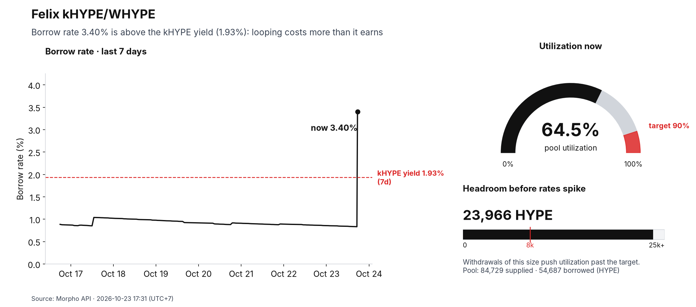
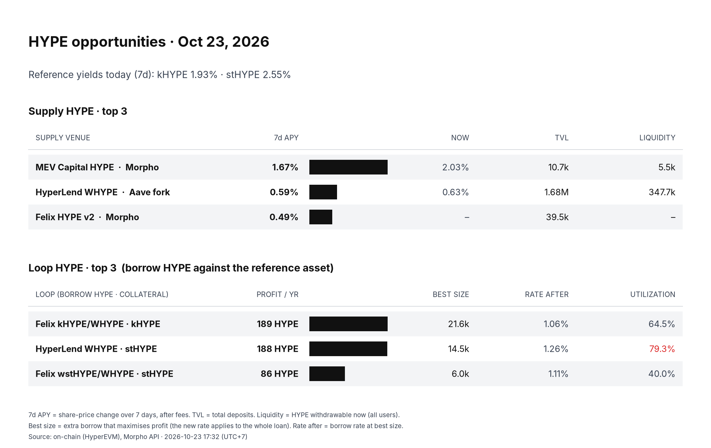

# lending-rate-alert

A small bot for people who **loop a liquid staking token** (borrow the base asset against the LST, stake it again).
It watches the borrow rate and utilization of the lending markets you use and tells you on Telegram when looping
stops paying. Once a day it sends a digest: where to supply the asset, and which loop pays the most right now.

Works with **Aave v3 forks, Morpho Blue and Euler v2** on any EVM chain. Everything chain-specific lives in one
`config.json`. The example config tracks five WHYPE markets on HyperEVM (HyperLend, Felix, Euler Clearstar) against
the kHYPE and stHYPE yields, and runs as is.

| Alert | Daily digest |
|---|---|
|  |  |

## What it alerts on

One alert type, two triggers (either is enough):

- **Spike:** borrow rate ≥ its 24h median + 1 pt. Fires even while still below the reference yield, because a jump
  from 0.2% to 1.2% is the early warning.
- **Above yield:** borrow rate > the reference yield (the LST you loop) for `hold_min` minutes in a row. Use a
  short hold (30 min) for markets that jump fast, and a long one (3 h) for Morpho markets that sit near the yield,
  or they spam.

Then: a "rising" message each time the rate climbs another 1 pt, and one "back to normal" message when it is below
the yield and back near its median. Each alert is one Telegram message with its own chart: 7-day rate with the
yield line, utilization gauge, and **headroom**, meaning how much can be withdrawn before utilization passes the
kink and rates jump.

## What the digest shows

- **Supply top 3:** 7-day APY from share-price growth (ERC-4626 vaults) or liquidity-index growth (Aave), after
  fees, plus the current rate, TVL and withdrawable liquidity. Also picks the "safest" venue (enough TVL and
  liquidity, configurable).
- **Loop top 3:** for each market and collateral, the extra borrow that maximises yearly profit. The new rate
  applies to the whole loan, so borrowing all the room up to the yield earns nothing; the best size is in between.
  Rate curves come from the protocol (Aave strategy, Euler IRM) or the Morpho adaptive-curve shape.

## Setup

```bash
git clone https://github.com/maxvu159/lending-rate-alert && cd lending-rate-alert
python3 -m venv .venv && .venv/bin/pip install -r requirements.txt
cp config.example.json config.json            # edit: chain, asset, yields, markets, digest
.venv/bin/python bot/alert.py --dry-run         # reads every market, writes nothing
.venv/bin/python bot/alert.py --force <market-key> --demo-rate 3.5   # preview an alert (prints it)
.venv/bin/python bot/digest.py                  # prints the digest and writes data/out/digest.png
```

Telegram: create a bot with @BotFather, add it to your group, then put this in `.env`:

```
TELEGRAM_BOT_TOKEN=123:abc
TELEGRAM_CHAT_ID=-100xxxxxxxxxx
TELEGRAM_THREAD_ID=                 # forum topic id, optional
```

Without a token the bot prints messages to stdout, which is handy for a first run. Schedule it with cron
(`deploy/crontab.example`, wrapper `deploy/run.sh`): alerts every 10 minutes, digest once a day. The bot keeps its
state in `data/` (`state.json`, `history.jsonl`, `out/`); `RATE_BOT_DATA` moves it, `RATE_BOT_CONFIG` points at
another config.

Font: set `"font"` in the config to an installed family (Inter looks best); otherwise DejaVu Sans.

## Config

| Key | Meaning |
|---|---|
| `chain.rpc` | an **archive** RPC (7-day yields read state 7 days back) |
| `chain.morpho_chain_id` | chain id in the Morpho API |
| `chain.blocks_per_day` | rough block rate to find the block 7 days ago; yields use real block timestamps |
| `asset` | the loan asset (symbol, address, decimals) |
| `yields.<name>` | reference yields: `exchange_rate` (a view call such as `kHYPEToHYPE(uint256)`), `erc4626` (`convertToAssets`), `balance_ratio` (two balances of one wallet), `fixed` |
| `markets[]` | `kind` `aave` (`atoken`), `morpho` (`market` id or prefix), `euler` (`vault`); `yield` to compare with; `hold_min`; optional `history: "hyperlend_api"`, `gauge_min`, `loop_collateral`, `curve` (for Aave strategies older than v3.2) |
| `alerts` | `spike_pts`, `escalate_pts` |
| `digest` | `supply_vaults[]`, `extra_loops[]`, TVL and liquidity thresholds |
| `telegram` | `chat_id`, `thread_id` (the token is env only) |

Adding a market on another chain usually means: a new `chain` block, the loan `asset`, one `yields` entry for the
LST, and one line per market. Run `alert.py --dry-run` and `digest.py` and compare a few numbers with the
protocols' apps before turning on Telegram.

## Notes and limits

- Rates are borrow APR for Aave (on-chain `currentVariableBorrowRate`), borrow APY for Morpho (API) and Euler.
- Euler has no rate history API; its chart uses the bot's own 10-minute samples, so it needs a few runs first.
- Morpho's curve uses the adaptive-curve shape with the current rate-at-target; it is an estimate for sizing loops,
  not a promise.
- Market data only. The bot never reads or moves positions.

## Tests

```bash
.venv/bin/python -m unittest discover tests
```

## License

MIT
